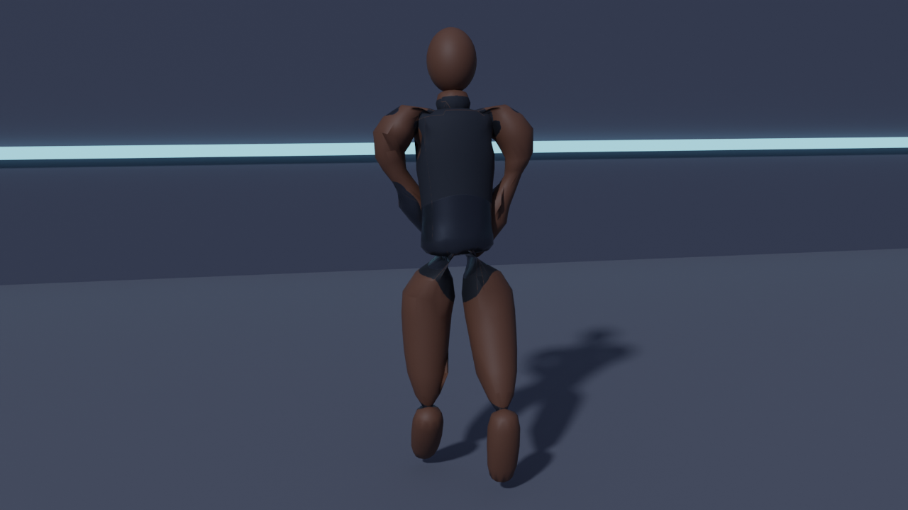
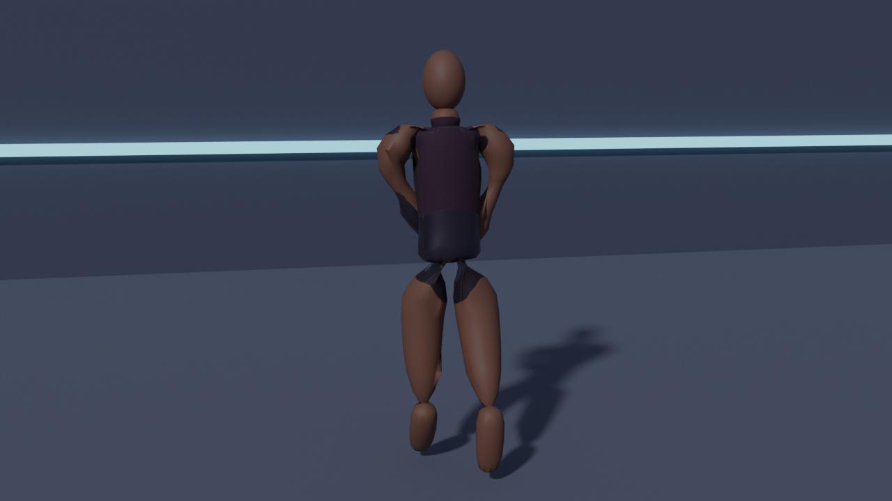
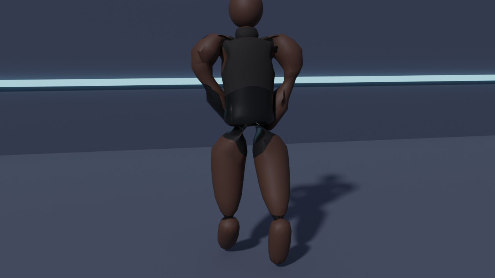
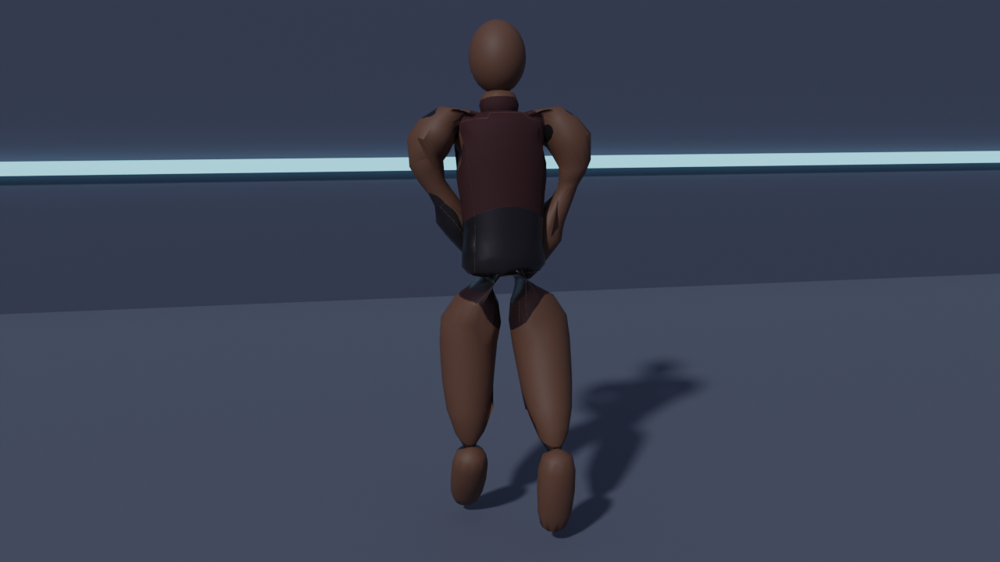
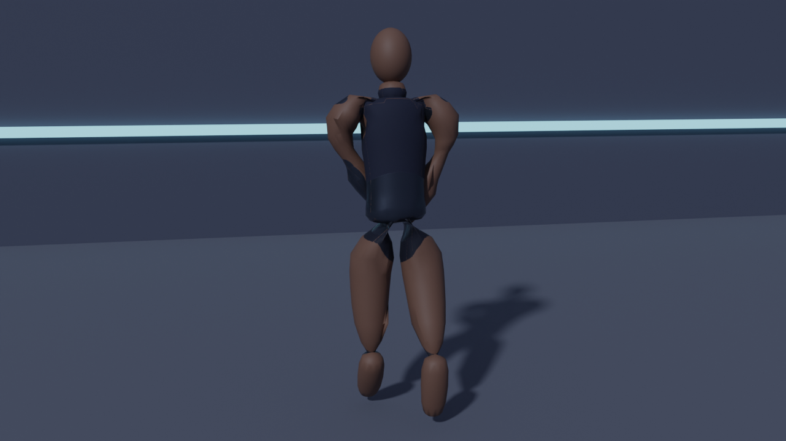
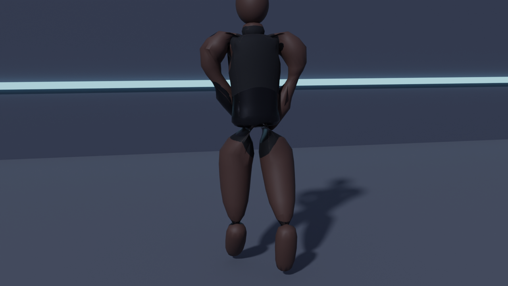
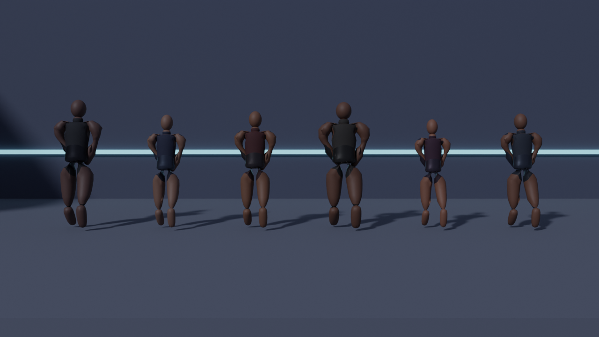

# BLOODLINE

Side-on 3D fighting game, Android first. A courier tore the Veil open by
accident and kept walking through it; the game is about fighting people
who are also walking through it.

Built with **Godot 4.7.2**. Budget: **$0**. Target: **any Android device**.

---

## Play it

The debug APK is built by GitHub Actions and published as a workflow
artifact.

1. Open the **Actions** tab on this repository.
2. Pick the **Android APK** run.
3. Download the **`bloodline-debug-apk`** artifact at the bottom of the run.

The artifact is a ZIP containing `bloodline-debug.apk`. Install it on an
Android device (you will need to allow installs from your file manager or
sideload it over ADB with `adb install bloodline-debug.apk`).

The build workflow lives at
[`.github/workflows/android-apk.yml`](.github/workflows/android-apk.yml) and
runs on every push to the branch and on every pull request. It lints the
GDScript, imports the project, exports the APK, uploads it as the
`bloodline-debug-apk` artifact, and then runs the headless smoke test.

---

## What is in the game

Everything in the list below is implemented and reachable from the menus.
There are no placeholder buttons.

| Screen | What it does |
| --- | --- |
| Boot | Veil-seam logo and drone, then hands over to the menu |
| Main Menu | Play, Fighters, Practice, Collection, Settings. No Online button, because there is no online mode |
| Fighter Select | The roster with real in-game portraits, and the real unlock condition on anyone still locked |
| Versus Setup | Opponent, difficulty, arena, round count, round length, meter rule |
| Loading | Warms the fighter models and the arena so the match starts clean |
| VS Card | The two fighters face off |
| Match | 60-second rounds, best of 1/3/5, health, guard, meter, hit-stop, ghost health bar, on-screen controls |
| Results | Rewards credited only after the save succeeds, one-tap rematch |
| Practice | Dummy with selectable behaviour, live combo and damage counters, move list with frame data, reset |
| Collection | Mastery and cosmetics. Mastery never changes a fighter's stats |
| Settings | Audio, haptics, graphics quality, control layout, language, reset save |

### The roster

Every shot below is the fighter standing in the Circuit Pit, rendered from
the same model, rig, costume bake and animation the match loads — the same
image the fighter select, collection and versus card show in game.

| Fighter | Style | Notes |
| --- | --- | --- |
| The Unbound | Balanced | Veil Reinforcement, 50 meter |
| Nyra | Rushdown | Fast, punishes slow pokes |
| Dagan | Defender | Armoured, slow, brief reinforcement |
| Kael | Pressure | Heat and sustain, unlock: win 2 matches |
| Sable | Space | Odd spacing, unlock: win 5 matches |
| Voss | Boss | Arrives with the Veil campaign |

#### The Unbound — balanced, Veil Reinforcement



#### Nyra — rushdown



#### Dagan — defender



#### Kael — pressure



#### Sable — space



#### Voss — boss



#### The full roster



### The arenas

Circuit Pit, Old Quarter Courtyard, Meridian Test Hall.

---

## The combat rules

These are the rules the code enforces, not aspirations.

- Every move has **startup**, **active** and **recovery** frames. Recovery
  is punishable.
- The **AI uses the same rules as the player**: the same health, frame
  data, cooldowns, meter costs and hit volumes. Difficulty changes
  decision quality only — reaction delay, spacing preference, punish rate
  and resource management. There are no hidden damage multipliers.
- **Guard** has its own meter. Block until it breaks and the guard break
  is telegraphed before it lands.
- **Dodge** has invulnerability frames followed by a real recovery.
- The **signature ability** has a visible tell, a meter cost and a long
  recovery.
- **Facing is automatic** and the control direction flips on a side
  switch.
- **Hit-stop** is 3–5 frames depending on the move.
- **Meter fills from being hit**, so being hit is a resource.
- The simulation runs on a **fixed 60 Hz tick** and is deterministic.

### Data-driven moves

Every move lives in [`Game/data/moves.json`](Game/data/moves.json):

```json
"light_attack": {
  "startup": 6, "active": 3, "recovery": 11,
  "damage": 55, "chip_damage": 6,
  "hitstun": 16, "blockstun": 9, "hitstop": 3,
  "pushback": 2.4, "guard_damage": 12,
  "cancel_window": [7, 19],
  "hitbox": { "shape": "box", "size": [0.85, 0.55, 0.65], "offset": [0.62, 0.0, 1.05] },
  "animation": "light_attack"
}
```

Per-fighter tuning (damage, frame data, reach, cooldowns) is layered on top
from `move_overrides` in
[`Game/data/fighters.json`](Game/data/fighters.json), so balance changes
never require touching code.

---

## Layout

```
Game/                       Godot project root
  project.godot
  export_presets.cfg        Android export preset
  data/                     fighters, moves, arenas (JSON)
  scenes/                   one scene per screen
  scripts/
    core/                   ContentDB, SaveSystem, AudioDirector, SceneRouter, Theme
    combat/                 Fighter, MatchManager, AIController, Arena, CameraRig, PlayerController
    ui/                     one script per screen, plus the HUD and touch controls
  assets/
    characters/*.glb        six fighters, 13 animation clips each
    portraits/*.png         fighter select portraits, rendered from the same rig
    screenshots/*.png       the fighter standing in the arena, used in the menus and the README
    preview/*.png           turnaround renders used for art review
  tools/
    smoke_test.gd           headless test: every screen, a whole match, the save
    smoke_test.tscn         the scene that runs it

tools/
  blender/                  the asset pipeline
    bloodline_rig.py        shared 22-bone rig, lofted body, region costume baker
    bloodline_anim.py       the 13 shared animation clips
    generate_fighters.py    the six-fighter roster generator
    make_portraits.py       portrait renderer
    make_screenshots.py     in-arena screenshot renderer
    preview_fighter.py      turnaround renderer
  gdscript/
    reorder_definitions.py  keeps the GDScript in gdtoolkit's class order

BLOODLINE_Preproduction_Plan/   the original design package
Docs/                            the project review and execution plan
```

---

## The asset pipeline

Every character asset is generated from source, so nothing is licensed
from a third party and nothing has to be downloaded.

```bash
# Requires Blender 4.5 with the bpy module.
LD_LIBRARY_PATH=... python tools/blender/generate_fighters.py
LD_LIBRARY_PATH=... python tools/blender/make_portraits.py
LD_LIBRARY_PATH=... python tools/blender/make_screenshots.py
LD_LIBRARY_PATH=... python tools/blender/preview_fighter.py unbound
```

The pipeline builds a shared 22-bone rig, lofts the body from aligned
cross-sections, fuses it into one surface, bakes the costume into a
texture over the body UVs, and authors 13 animation clips that every
fighter shares. The output is a glTF 2.0 binary that Godot imports
natively, validated against the Khronos glTF validator with zero errors.

---

## Ground rules

These are not negotiable and are enforced by the design:

- **No monetisation.** No purchases, no currency, no store.
- **No fake features.** Every button does something real.
- **No dead UI.** Locked fighters show a real, visible unlock condition.
- **Mastery never inflates stats.** It unlocks cosmetics and new choices.
- **Offline first.** Progress is stored locally; there is no account, no
  server and no telemetry.
- **Portraits match the model.** The portrait is rendered from the same rig
  the match loads.

---

## Development

```bash
# Lint and format the GDScript.
pip install gdtoolkit==4.5.0
cd Game && gdlint scripts tools && gdformat scripts tools

# Import the project and export a debug APK locally.
godot --headless --path Game --import
cd Game && godot --headless --export-debug "Android" build/bloodline-debug.apk

# Run the headless smoke test: every screen, a whole AI match, the save.
cd Game && godot --headless --path . res://tools/smoke_test.tscn
```

The smoke test builds all eleven screens, runs a 600 frame match with the
AI driving the opponent, checks that the AI actually lands hits and that
a match can only be credited once. It prints `smoke: PASSED` at the end.
The CI workflow runs it on every build and fails the build if it does not
pass or if any script logs an error, so a broken screen can never reach
the APK.

The Android export needs JDK 17, the Android SDK (platform-tools,
build-tools 35.0.1, platforms android-35) and the Godot 4.7.2 export
templates installed at
`~/.local/share/godot/export_templates/4.7.2.stable/`. The export output
path is resolved relative to the project directory, so the export is run
from inside `Game/`. The CI workflow does all of this for you.
